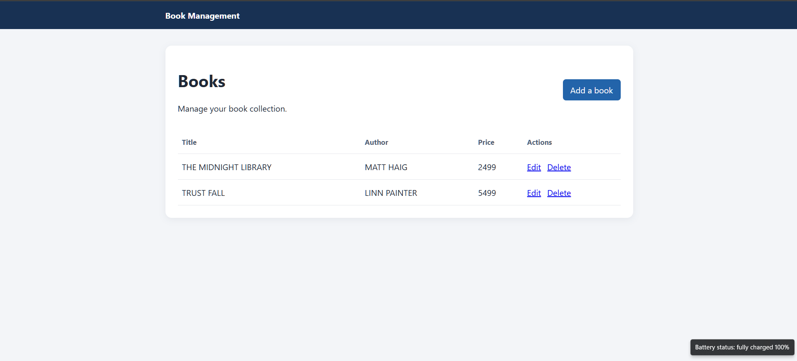
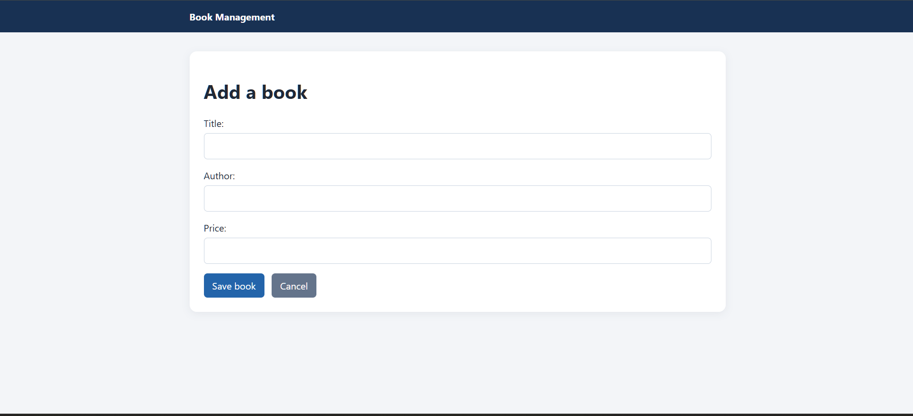
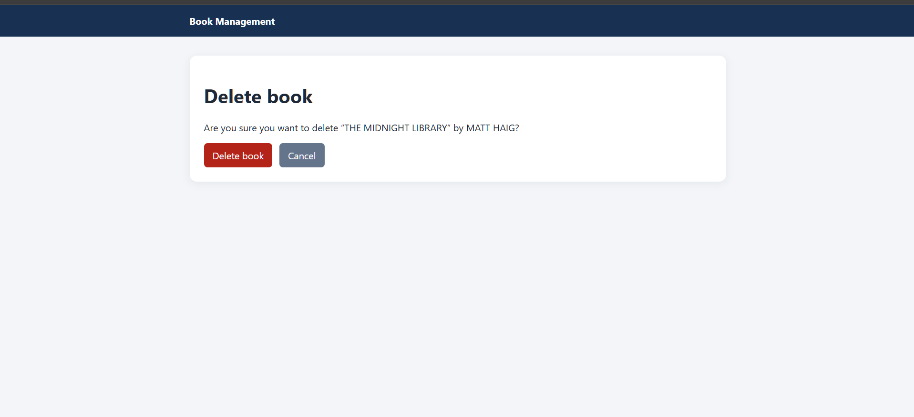

# CRUD-Book-Management-System
# Exercise: Django MVT – CRUD Operations
# Title: Book Management System
## Register No:26010888
## Date:15-11-26

## Aim: To develop a simple Book Management System using Django MVT architecture and perform CRUD operations using Django ORM.

## Problem Statement:

Create a Django web application to manage book details. The application should allow users to add, view, update, and delete book records.

## Model Details:

Create a `Book` model with the following fields:

1. `title` – CharField
2. `author` – CharField
3. `price` – IntegerField

## Tasks to Perform:

1. Create a Django project and an application.
2. Define the `Book` model and perform database migrations.
3. Implement the Create operation to add new book details.
4. Implement the Read operation to display all books.
5. Implement the Update operation to modify a book's price.
6. Implement the Delete operation to remove a book record.
7. Configure URL routing and create the required HTML templates.
8. Test all CRUD operations in the browser.

## Source Code:
```python
from django.db import models


class Book(models.Model):
    title = models.CharField(max_length=200)
    author = models.CharField(max_length=200)
    price = models.IntegerField()

    def __str__(self):
        return self.title
```

## Output:





## Result:
A working Django MVT application that performs Create, Read, Update, and Delete operations on book records using Django ORM.
